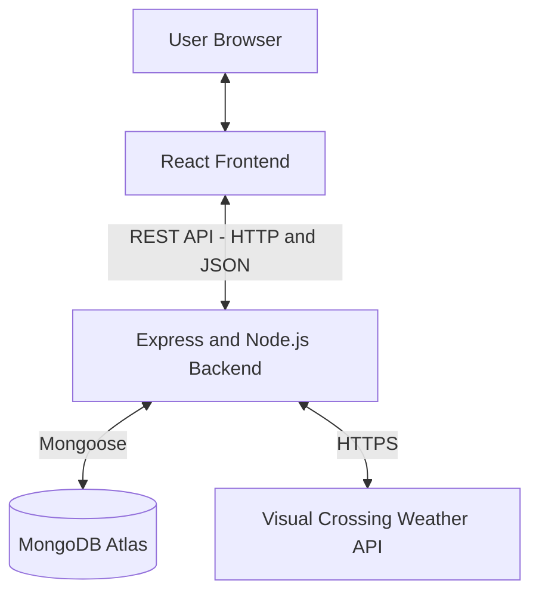
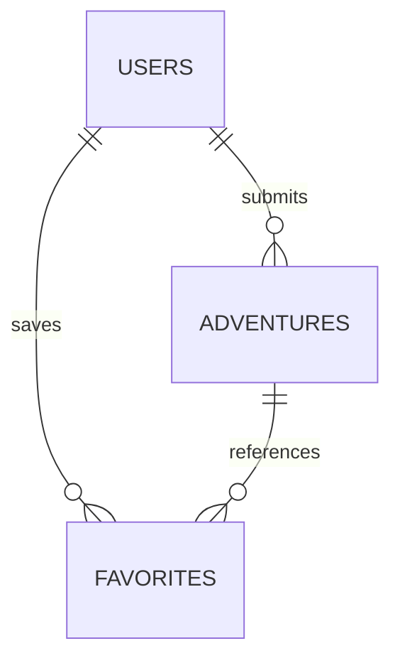
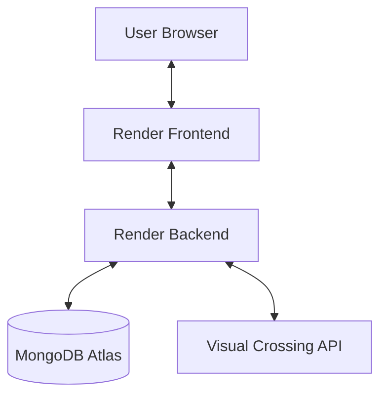

# Little Adventures — Explore Lebanon

**Final Full-Stack Web Application Capstone**

- **Course:** Web Programming – 020WBPES3
- **University:** USJ – ESIB
- **Developed by:** Mira Chakra and Fatima Hamze

## Live Deployment

The application is deployed on Render and publicly accessible.

| Service | URL |
|---|---|
| Frontend | https://little-adventures-frontenf.onrender.com/ |
| Backend | https://little-adventures-1.onrender.com/ |
| API Health Check | https://little-adventures-1.onrender.com/api/health |
| Adventures API | https://little-adventures-1.onrender.com/api/adventures |

The production database is hosted on MongoDB Atlas.

---

## 1. Project Overview

Little Adventures is a full-stack web application designed to help users discover places and activities across Lebanon.

The application provides personalized recommendations based on users' interests, budget, available time, location and weather conditions.

It also allows users to save their favorite adventures, manage their visit history and suggest new places. Administrators can manage the catalogue and review community submissions.

## 2. Problem Statement

Planning an outing in Lebanon can be difficult because information about activities, locations, prices and weather conditions is distributed across multiple platforms.

Little Adventures centralizes this information into a single platform, helping users discover suitable activities more easily and efficiently.

## 3. Main Features

### User Features

- User registration, login and logout.
- Browse a catalogue of 37 initial adventures across Lebanon.
- Search and filter adventures by:
  - Region
  - Category
  - Mood
  - Budget
  - Duration
  - Difficulty
  - Indoor or outdoor setting
- View detailed adventure information.
- Explore places using an interactive map.
- View seven-day weather forecasts using Visual Crossing.
- Receive personalized recommendations through Pick for Me.
- Save and remove favorite adventures.
- Manage personal visit history.
- Submit new adventure suggestions.
- View the status of submitted suggestions.

### Admin Features

- Secure administrator authentication.
- Create new adventures.
- Edit existing adventures.
- Delete adventures.
- Manage draft and published adventures.
- Approve or reject user suggestions.
- Preview and import adventure records using JSON.
- Detect duplicate records during import.
- Manage the adventure catalogue.

## 4. Technologies Used

| Component | Technology |
|---|---|
| Frontend | React.js |
| Frontend Build Tool | Vite |
| Client-side Routing | React Router |
| Backend | Node.js, Express.js |
| Database | MongoDB Atlas |
| ODM | Mongoose |
| Authentication | JWT |
| Password Hashing | bcrypt |
| Input Validation | Zod |
| Security | Helmet, Express Rate Limit |
| Weather API | Visual Crossing |
| Interactive Map | Leaflet, React Leaflet |
| Frontend Testing | Vitest, React Testing Library |
| Backend Testing | Node.js Test Runner, Supertest |
| Version Control | Git and GitHub |
| Deployment | Render |

## 5. System Architecture

The application follows the MERN stack architecture:

- MongoDB
- Express.js
- React.js
- Node.js



### Frontend

The frontend is responsible for:

- Displaying the user interface.
- Handling user interactions.
- Managing client-side navigation.
- Sending HTTP requests to the backend.
- Displaying data received from the API.

### Backend

The backend is responsible for:

- Authentication and authorization.
- Input validation.
- Business logic.
- CRUD operations.
- Database communication.
- Weather API integration.
- Adventure recommendations.

### Database

MongoDB Atlas stores the application's persistent data.

Mongoose is used to define schemas, validate documents and interact with MongoDB.

The frontend does not connect directly to the database. All database operations are performed through the Express backend.

## 6. Database Schema

The application uses three main MongoDB collections.

| Collection | Description |
|---|---|
| users | Stores user accounts, hashed passwords and roles. |
| adventures | Stores adventure information, publication status and community suggestions. |
| favorites | Stores saved adventures and personal visit history. |

### Database Relationships



For more information, see:

- [Database Schema](docs/DATABASE_SCHEMA.md)
- [Architecture](docs/ARCHITECTURE.md)
- Current Mongoose models in `server/src/models/`.

## 7. Project Structure

```text
Little_Adventures_Expanded/
│
├── client/
│   ├── public/
│   │   └── photos/
│   └── src/
│       ├── components/
│       ├── pages/
│       └── lib/
│
├── server/
│   ├── data/
│   ├── src/
│   │   ├── models/
│   │   ├── routes/
│   │   ├── middleware/
│   │   └── utils/
│   ├── test/
│   └── .env.example
│
├── docs/
├── .gitignore
├── package.json
├── render.yaml
└── README.md
```

The frontend and backend are separated to improve maintainability, organization and scalability.

## 8. Installation Instructions

### Prerequisites

- Node.js 24 or later.
- npm.
- MongoDB Atlas account.
- Visual Crossing API key.
- Git.

### Install Dependencies

Open a terminal in the root project directory.

For Windows PowerShell:

```powershell
npm.cmd install
npm.cmd run install:all
```

### Configure Environment Variables

Create a private `server/.env` file using `server/.env.example`.

```env
PORT=5000
MONGODB_URI=YOUR_MONGODB_CONNECTION_STRING
JWT_SECRET=YOUR_SECRET_KEY
VISUAL_CROSSING_KEY=YOUR_WEATHER_API_KEY
NODE_ENV=development
```

Replace the placeholders with your own credentials.

Environment variables are used to protect sensitive information. The `.env` file must not be committed to GitHub.

### Initialize the Database

For a new database only, configure `SEED_ADMIN_EMAIL` and `SEED_ADMIN_PASSWORD` temporarily and run:

```powershell
npm.cmd run seed --prefix server
```

Remove the temporary seed credentials after initialization.

For an existing installation, keep the existing database and administrator account.

### Import the Adventure Catalogue

Preview the catalogue changes:

```powershell
npm.cmd run catalog:preview --prefix server
```

Apply the changes after reviewing the preview:

```powershell
npm.cmd run catalog:apply --prefix server
```

### Run the Application Locally

```powershell
npm.cmd run dev
```

Local development URLs:

- Frontend: http://localhost:5173
- Backend: http://localhost:5000
- API Health Check: http://localhost:5000/api/health

## 9. REST API

The frontend communicates with the backend through a REST API using HTTP requests and JSON responses.

| HTTP Method | Purpose |
|---|---|
| GET | Retrieve information |
| POST | Create new resources |
| PATCH / PUT | Update existing resources |
| DELETE | Delete resources |

Main API resources include:

- `/api/health`
- `/api/auth`
- `/api/adventures`
- `/api/favorites`
- Community suggestions and review operations.
- Personal visit history operations.

Protected endpoints require authentication. Administrator operations also require the admin role.

## 10. Authentication and Security

The application implements several security mechanisms:

- Password hashing using bcrypt.
- JWT-based authentication.
- HttpOnly cookies.
- Role-based authorization.
- Protected frontend pages.
- Protected backend API endpoints.
- Server-side input validation using Zod.
- Security headers using Helmet.
- Rate limiting to reduce abuse.
- Protection against unauthorized administrator access.
- CSRF protection mechanisms.
- Environment variables for sensitive credentials.
- User-specific access to favorites and visit history.

The backend verifies authentication and authorization independently of frontend restrictions.

## 11. External API Integration

### Visual Crossing Weather API

Little Adventures integrates Visual Crossing to retrieve seven-day weather forecasts.

Weather information includes:

- Minimum temperature.
- Maximum temperature.
- Probability of precipitation.
- Wind speed.
- Weather conditions.

The backend communicates directly with the weather API to protect the API key.

To improve performance, the application uses:

- Server-side caching.
- Deduplication of identical locations.
- Limited concurrent API requests.
- Request timeouts.
- Graceful error handling when weather information is unavailable.

### Interactive Map

The application uses Leaflet and React Leaflet to display adventure locations on an interactive map.

Users can explore places geographically and access location information and directions.

## 12. Recommendation System

The Pick for Me feature provides personalized adventure recommendations based on:

- User interests.
- Available budget.
- Available time.
- Preferred region.
- Difficulty.
- Weather conditions.
- Optional geographical location.

The recommendation system uses a rule-based scoring and ranking algorithm.

It filters unsuitable adventures and ranks matching activities according to user preferences.

The current recommendation system is not a machine learning model.

## 13. Performance Optimization

The application includes several performance optimizations:

- Database pagination.
- Server-side weather caching.
- Deduplication of weather requests.
- Limited concurrent weather API requests.
- Lazy loading of selected frontend components.
- Production optimization using Vite.
- Locally stored catalogue images.
- Graceful handling of unavailable external services.

## 14. Automated Testing

The application includes 50 automated tests covering both frontend and backend functionality.

### Test Results

| Test Category | Total | Passed | Failed |
|---|---:|---:|---:|
| Backend Tests | 36 | 36 | 0 |
| Frontend Tests | 14 | 14 | 0 |
| **Total** | **50** | **50** | **0** |

**Test success rate: 100%.**

### Backend Testing

Backend tests are implemented using the Node.js test runner and Supertest.

They cover:

- API health checks.
- Authentication.
- Authorization.
- Protected routes.
- Administrator permissions.
- Input validation.
- Security mechanisms.
- Recommendation ranking.
- Weather API integration using simulated responses.
- Weather caching.
- Favorites.
- Community submissions.
- Approval and rejection of suggestions.
- Personal visit history.
- Database pagination.
- Catalogue import and duplicate detection.

### Frontend Testing

Frontend tests are implemented using Vitest and React Testing Library.

The test files include:

- `App.test.jsx`
- `Community.test.jsx`
- `Expansion.test.jsx`
- `Map.test.jsx`

### Run All Tests

```powershell
npm.cmd test
```

Latest local results:

```text
Backend:
Tests: 36
Passed: 36
Failed: 0

Frontend:
Test Files: 4 passed
Tests: 14 passed

Total: 50/50 tests passed
```

The weather tests deliberately simulate an unavailable API to verify error handling. An offline message during this test is expected.

## 15. Production Build

To generate the production frontend build:

```powershell
npm.cmd run build
```

Latest local build results:

```text
1612 modules transformed successfully.
Production build completed successfully.
```

The production build is generated using Vite in the `client/dist` directory.

All 50 automated tests and the production build passed successfully during local verification.

## 16. Capstone Milestones

### Milestone 1 — Project Scaffold, Wireframes and Database Schema

Deliverables:

- GitHub repository containing the frontend and backend.
- React application with client-side routing.
- Express server with an API health endpoint.
- MongoDB database configuration.
- Environment variables configuration.
- Wireframes of the main application screens.
- Database schemas and relationships.

Supporting documentation:

- [Wireframes](docs/WIREFRAMES.md)
- [Database Schema](docs/DATABASE_SCHEMA.md)
- [Architecture](docs/ARCHITECTURE.md)

### Milestone 2 — Core Backend Functionality

Deliverables:

- User registration and login.
- Password hashing.
- JWT authentication.
- Protected API routes.
- Role-based authorization.
- RESTful CRUD operations.
- Server-side input validation.
- MongoDB integration.
- Security mechanisms.

Implementation can be found in the `server/src` directory.

### Milestone 3 — Frontend and Backend Integration

Deliverables:

- React frontend connected to the Express API.
- User registration, login and logout through the interface.
- Protected user and admin pages.
- Adventure search and filtering.
- Interactive maps.
- Personalized recommendations.
- External weather API integration.
- Favorites and personal visit history.
- Community suggestions.
- Responsive user interface.

Implementation can be found in the `client/src` directory.

### Milestone 4 — Live Deployment

Deliverables:

- Frontend deployed on Render.
- Backend deployed on Render.
- Production database hosted on MongoDB Atlas.
- Production environment variables configured.

Frontend:

https://little-adventures-frontenf.onrender.com/

Backend:

https://little-adventures-1.onrender.com/

API Health Check:

https://little-adventures-1.onrender.com/api/health

The live URLs allow the application and its API to be verified independently.

### Milestone Tracking

Project progress is documented through the repository's GitHub commit history, available milestone evidence and project documentation.

See [Milestones Documentation](docs/MILESTONES.md).

## 17. Technical Challenges and Solutions

### Challenge 1: MongoDB Atlas Connection

During deployment, the backend initially experienced difficulties connecting to MongoDB Atlas.

The problem was addressed by configuring the MongoDB connection string, database network access and production environment variables.

### Challenge 2: Frontend and Backend Communication

The frontend and backend were deployed as separate services on Render.

To support communication between them, API routing and redirect/rewrite rules were configured.

### Challenge 3: Weather API Integration

The weather provider was changed from Open-Meteo to Visual Crossing.

The backend weather service and corresponding automated tests were updated to support the new API response format.

Weather caching, location deduplication, request limits and error handling were preserved.

Following the update, all 50 automated tests passed.

## 18. Deployment

The application uses the following production architecture:



### Frontend Deployment

- Hosting platform: Render.
- Framework: React and Vite.
- Build output: `client/dist`.
- Client-side routing supported through rewrite rules.

### Backend Deployment

- Hosting platform: Render.
- Runtime: Node.js.
- Framework: Express.js.
- Production environment variables configured privately.

### Database Deployment

- Hosting platform: MongoDB Atlas.
- Database access through Mongoose.
- Connection credentials stored in environment variables.

## 19. Data Reliability and Limitations

The application includes an initial catalogue of 37 source-linked places with photographs and visible credits.

Estimated costs and durations are provided for planning purposes and may not represent verified admission prices.

Coordinates may represent the general location of a place rather than its exact entrance.

Users should verify current prices, opening hours, access conditions and weather before visiting.

Photograph sources and licences are documented in `docs/PHOTO_CREDITS.md`.

## 20. Future Improvements

Possible future improvements include:

- AI-powered personalized recommendations.
- User ratings and reviews.
- Automatic itinerary generation.
- Multi-day adventure planning.
- Real-time opening hours.
- Verified activity pricing.
- Online booking integration.
- Automatic discovery of new places.
- Multiple photographs for each adventure.
- Multilingual support.

## 21. Project Documentation

Additional documentation is available in the `docs` directory.

- [Architecture](docs/ARCHITECTURE.md)
- [Database Schema](docs/DATABASE_SCHEMA.md)
- [Wireframes](docs/WIREFRAMES.md)
- [Deployment Guide](docs/DEPLOYMENT.md)
- [Milestones](docs/MILESTONES.md)
- [Security Audit](docs/SECURITY_AUDIT.md)
- [Community Update](docs/COMMUNITY_UPDATE.md)
- [Interactive Map Update](docs/MAP_UPDATE.md)
- [Photo Credits](docs/PHOTO_CREDITS.md)
- [Catalogue Sources](docs/CATALOGUE.md)
- [Presentation Guide](docs/PRESENTATION.md)
- [QA Status](docs/QA_STATUS.md)
- [Windows Upgrade Guide](docs/UPGRADE_WINDOWS.md)

Some older documentation describes the original implementation.
The current source code and this README describe the expanded application.

## 22. External Resources

- React: https://react.dev/
- Vite: https://vite.dev/
- Node.js: https://nodejs.org/
- Express: https://expressjs.com/
- MongoDB Atlas: https://www.mongodb.com/atlas
- Mongoose: https://mongoosejs.com/
- Visual Crossing: https://www.visualcrossing.com/weather-api/
- Leaflet: https://leafletjs.com/
- Render: https://render.com/

## 23. Authors

Developed as part of the Web Programming Final Capstone Project at Saint Joseph University of Beirut (USJ – ESIB).

- Mira Chakra
- Fatima Hamze

## Conclusion

Little Adventures provides a centralized and personalized platform for discovering activities across Lebanon.

The project demonstrates full-stack development, database management, REST API integration, authentication, authorization, automated testing, security and cloud deployment.