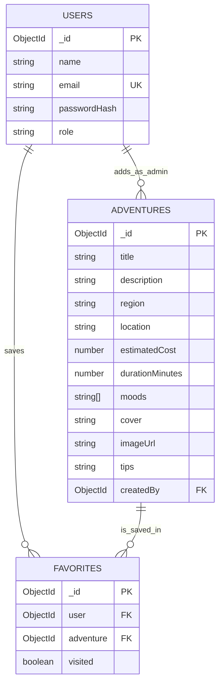

# MongoDB schema (Milestone 1 artifact)

MongoDB stores **documents** in **collections**. A document is a JSON-like object, and `_id` is its unique identifier.



### Relationships

- **One user → many favorites.** Favorites always use the **authenticated** user's ID, never a user ID sent in the request body.
- **One adventure → many favorites.** The pair `(user, adventure)` is unique, so a person cannot save the same item twice.
- **One admin → many created adventures.** `createdBy` identifies who inserted an adventure.

### Fields and why they exist

`Users.role` is either `user` or `admin`. Signup always sets `user`, never trusting a role from the browser. `passwordHash` contains a bcrypt password hash, not a password. `Adventures` holds the fields used by Explore, details, admin forms and the recommendation engine. `Favorites.visited` adds the optional mark-as-visited feature.

### Example (not a live record)

```json
{
  "title": "A Village Walk",
  "description": "Explore old streets and enjoy a relaxed afternoon.",
  "region": "Mount Lebanon",
  "location": "Chouf",
  "estimatedCost": 0,
  "durationMinutes": 120,
  "moods": ["relax", "culture"],
  "cover": "heritage"
}
```

### Implementation

Mongoose schemas are in `server/src/models/` and validation rules are in `server/src/utils/validation.js`. MongoDB creates the database/collections upon first insertion. The seed script creates initial records without locking them into the frontend.
